# Scriber

**An open-source design agent for mechanical CAD.** Describe a part in plain words and get a parametric, editable B-rep part or assembly back: STEP, STL, GLB and the script that built it. It runs offline on your own machine, with local Qwen models (Ollama) and an open kernel (OpenCASCADE through build123d).

The model never draws geometry. It writes a typed design, a compiler turns that into a solid, and the result is checked and repaired before you see it.

<p align="center">
  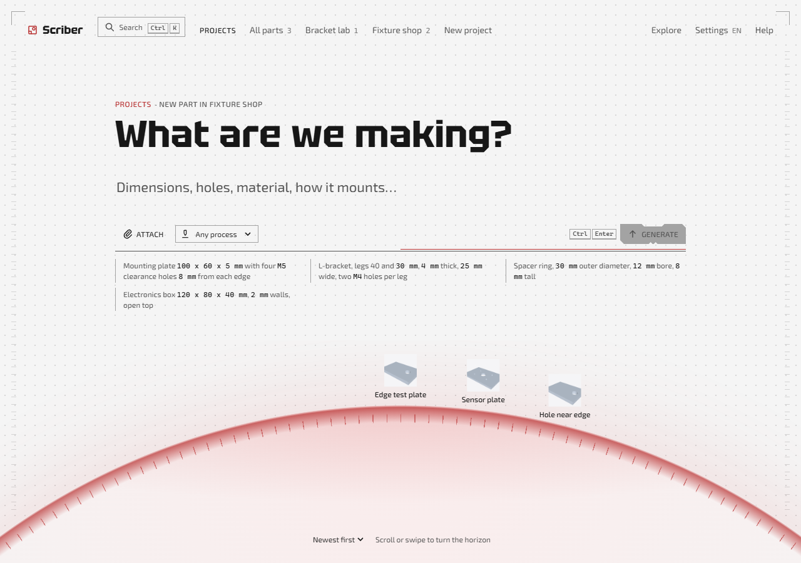
</p>
<p align="center"><sub>The web app's home page. Screenshot from the test suite, which runs the real interface on sample data.</sub></p>

## Contents

- [One request, start to finish](#one-request-start-to-finish)
- [More prompts](#more-prompts)
- [How it works](#how-it-works)
- [The design IR](#the-design-ir)
- [Components](#components)
- [The apps](#the-apps)
- [Where it stands](#where-it-stands)
- [Next steps](#next-steps)
- [Quick start](#quick-start)
- [Bring your own model](#bring-your-own-model)
- [Checks](#checks)
- [Project records](#project-records)
- [Licence](#licence)

## One request, start to finish

A real run from this repository, on a machine with a 6 GB GPU.

> **Prompt:** Spur gear pair, module 2: a 20-tooth pinion and a 40-tooth wheel, both 12 mm wide with 8 mm bores, meshing at the correct centre distance; expose module, pinion_teeth and wheel_teeth as parameters.

| 1. Generated | 2. Edited by parameter | 3. Edited in words |
|:---:|:---:|:---:|
| 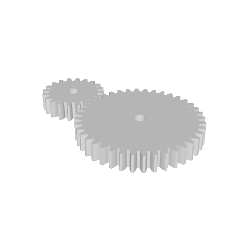 | 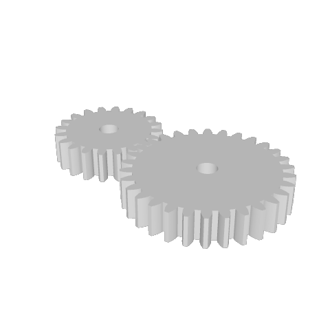 | 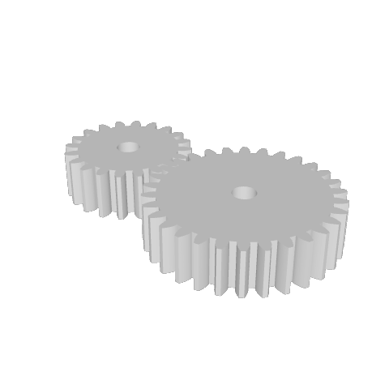 |
| 17.5 s, one attempt | 4.3 s, no model call | 6.1 s |
| Two valid solids, 60 mm between centres, no gap and no interference at the mesh | `wheel_teeth` 40 → 30; the centre distance follows to 50 mm | "make both gears 16 mm wide"; the width check passes |

Why the centre distance follows: the model did not place the wheel at a number. It wrote the position as an expression over the parameters, `module * (pinion_teeth + wheel_teeth) / 2`, so changing a tooth count moves the gear.

Each step is a new version. You can compare versions, restore one, and export any of them.

## More prompts

Two more runs, picked because they show the repair loop. The first answer was wrong in both; the checks caught it and the model fixed it.

| Prompt | Result | What happened |
|---|:---:|---|
| L-bracket, legs 40 and 30 mm, 4 mm thick, 25 mm wide, two M4 holes per leg | 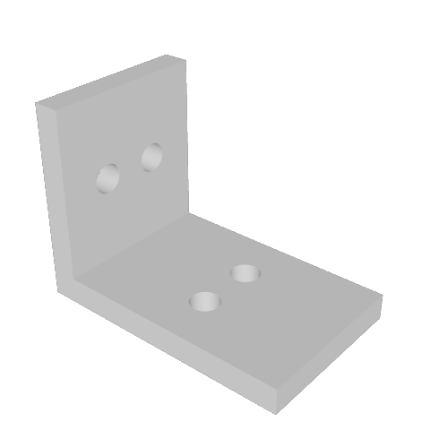 | 3 attempts, 2 repairs, 87 s. All 4 checks pass: three sizes and four M4 clearance holes. |
| Mounting plate 120 x 80 x 6 mm with four M6 clearance holes 10 mm from each edge, and a 1 mm chamfer on the top edges. | 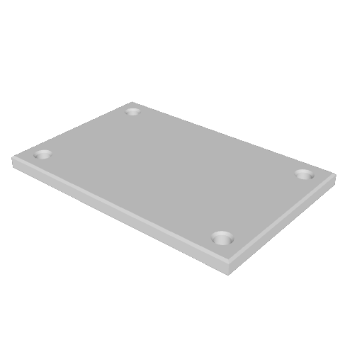 | 5 attempts, 4 repairs, 161 s. All 4 checks pass: three sizes and four M6 clearance holes. |

The images are rendered from the GLB files those runs exported. The app's own starter prompts are a good place to begin:

```text
Mounting plate 100 x 60 x 5 mm with four M5 clearance holes 8 mm from each edge
Spacer ring, 30 mm outer diameter, 12 mm bore, 8 mm tall
Electronics box 120 x 80 x 40 mm, 2 mm walls, open top
```

## How it works

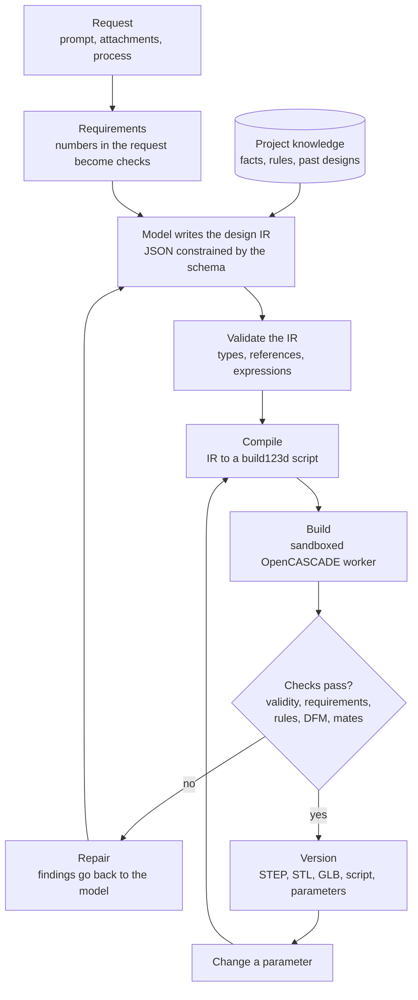

- **Requirements.** Dimensions and counts stated in the request become checks that are measured on the built solid: overall sizes, hole counts and diameters, hole spacing, wall thickness, counterbores.
- **Project knowledge.** Facts and rules from the files you gave the project, and the most similar earlier design, are put in front of the model.
- **Compile and build.** The compiler is deterministic: the same IR always gives the same script. The script runs in a separate worker process that may import only `math` and `build123d`, with a time limit.
- **Checks.** Every build is tested for a valid single solid per part, the requirements, the project's rules, manufacturability, and, for assemblies, gaps and interference at each joint.
- **Repair.** A failed check comes back as a finding with the measured value, the required value and where it is. The model edits the design and the loop runs again, up to five times.
- **Parameter edits skip the model.** Changing a value recompiles and rebuilds the same design.

## The design IR

The IR is the contract between the model and the kernel. It is a set of frozen, typed records; anything the schema does not allow is rejected before the kernel sees it.

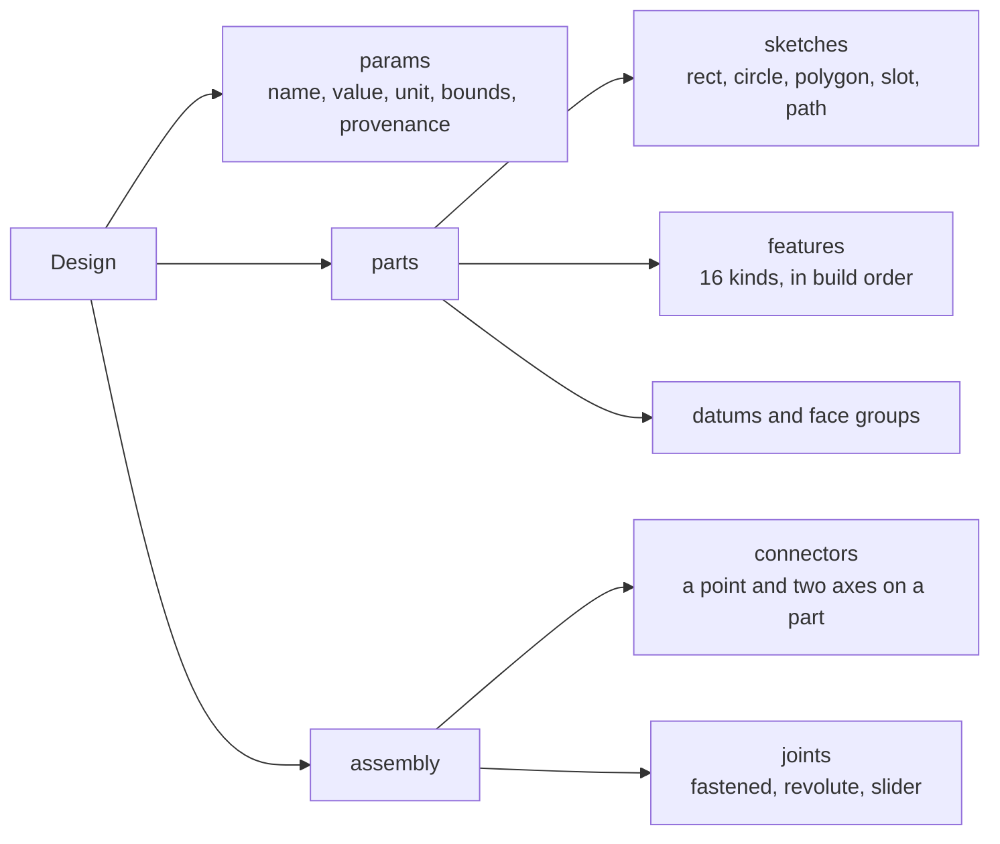

- **Parameters** are the only place numbers live. Each has a name, a value, a unit, optional bounds and a provenance: the phrase in the prompt, the document, or the default it came from.
- **Features** take each dimension as a number, a parameter name or an expression over parameters (`thickness * 2`), so one parameter can drive several features. The kinds are extrude, revolve, hole, pattern, fillet, chamfer, shell, loft, airfoil section, spur gear, rib, boss pattern, shell with lid, lid, keyway and groove.
- **Geometry is referred to by description, not by index.** A feature sits on `boss.top` or selects "the concave edges parallel to z", and the compiler resolves that against the solid on every build. There are no face numbers to go stale when the model changes.
- **Assemblies** place parts by joining connectors, so positions are derived, not typed in.

This is the gear pair's design, abridged (`data/models/<id>/v1/design.json`):

```jsonc
{
  "title": "Spur gear pair",
  "params": [
    { "name": "module", "value": 2.0, "unit": "mm", "provenance": { "source": "prompt", "quote": "module 2" } },
    { "name": "pinion_teeth", "value": 20.0, "unit": "", "provenance": { "source": "prompt", "quote": "20-tooth pinion" } }
    // wheel_teeth, face_width, bore_diameter
  ],
  "parts": [
    {
      "id": "pinion",
      "features": [
        { "kind": "spur_gear", "id": "gear", "intent": "driving gear", "module": "module", "teeth": "pinion_teeth",
          "face_width": "face_width", "bore": "bore_diameter", "pressure_angle": 20.0 }
      ]
    }
    // wheel: the same feature with "teeth": "wheel_teeth"
  ],
  "assembly": {
    "connectors": [
      { "id": "pinion_axis", "part": "pinion", "origin": ["module * (pinion_teeth + wheel_teeth) / 2", 0.0, 0.0] },
      { "id": "wheel_axis", "part": "wheel", "origin": [0.0, 0.0, 0.0] }
    ],
    "joints": [{ "id": "mesh", "parent": "pinion_axis", "child": "wheel_axis", "kind": "revolute", "angle": "180 / wheel_teeth" }]
  }
}
```

And what the compiler wrote for it (the end of `model.py`, which you can export and run yourself):

```python
def part_1():
    ...
    # gear Wheel Spur gear: driven gear
    pl, out = _ref(part, T, D, 'XY', 0.0)
    tool = _gear(pl, out, (0.0, 0.0), P['module'], P['wheel_teeth'], 20.0, 0.0, P['face_width'], P['bore_diameter'], None, None)
    part = _apply(part, tool, 'add')
    ...

def build():
    L = {p: Location() for p in ['pinion', 'wheel']}
    L['wheel'] = L['pinion'] * _mate((((P['module'] * (P['pinion_teeth'] + P['wheel_teeth']) / 2), 0.0, 0.0), '+z', '+x'), (180 / P['wheel_teeth']), 0.0, ((0.0, 0.0, 0.0), '+z', '+x'))
    return {'pinion': part_0().moved(L['pinion']), 'wheel': part_1().moved(L['wheel'])}
```

## Components

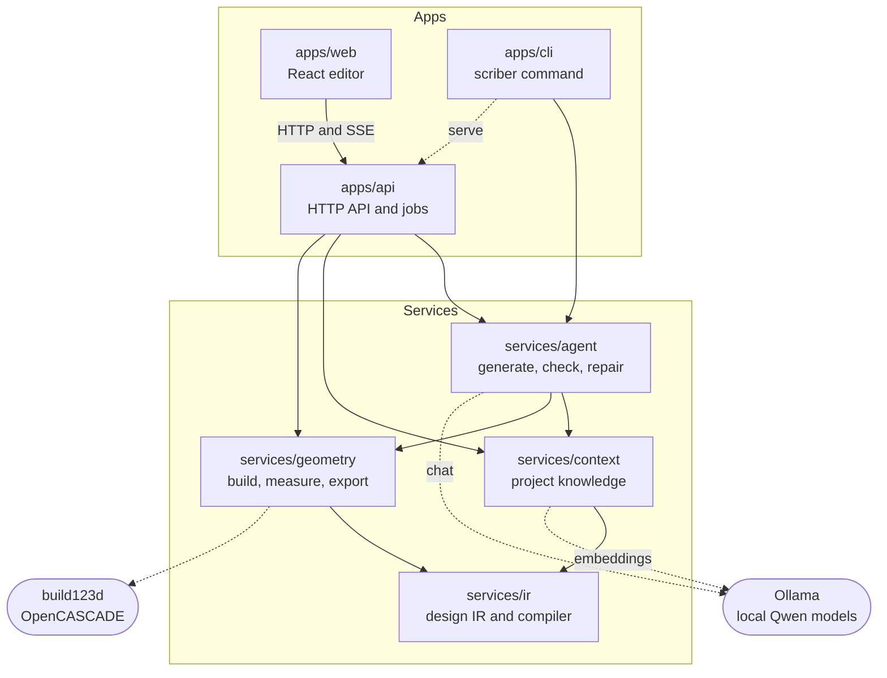

Imports only go downwards in this picture, and CI enforces it. Three more rules are enforced the same way: only `geometry` may import the kernel, the IR and `geometry` never import a model runtime, and `context` knows nothing about geometry or the agent.

| Path | What it does |
|---|---|
| `services/ir` | The design IR: its records and schema, validation, expressions, the compiler to build123d, assemblies and joints, default rules, materials. Pure Python, no kernel. |
| `services/geometry` | Runs compiled scripts in a sandboxed worker and measures the result: validity, sizes, holes, mass. Runs the DFM checks (hole-to-edge distance, wall thickness, hole size, internal corner radius, overhang angle, overall size). Exports STEP, STL, GLB and FreeCAD files, renders thumbnails, and works out which faces each feature made. |
| `services/context` | Turns engineering files (PDF, Word, Excel, CSV, text, Markdown, YAML, XML, STEP, STL and images) into cited facts and rules, stores them per project in SQLite with full-text and vector search, and retrieves what a request needs, including similar past designs. |
| `services/agent` | The loop above: extracts requirements, builds the prompt, calls the model behind a small interface (Ollama by default), validates, builds, checks and repairs. Also suggestions and design variants. |
| `apps/api` | FastAPI service: projects, uploads, generation jobs with live progress, versions, exports, sharing. |
| `apps/web` | The editor: 3D viewer, feature tree, parameters, checks, version timeline, project sources. |
| `apps/cli` | The `scriber` command; also starts the API. |
| `training` | Procedural generators that produce a request and its kernel-verified design, and the local QLoRA pipeline that fine-tunes the model on them. |
| `evals` | Eval cases, the scoring harness and the acceptance demos behind the parity report. |

## The apps

### Web editor

<p align="center">
  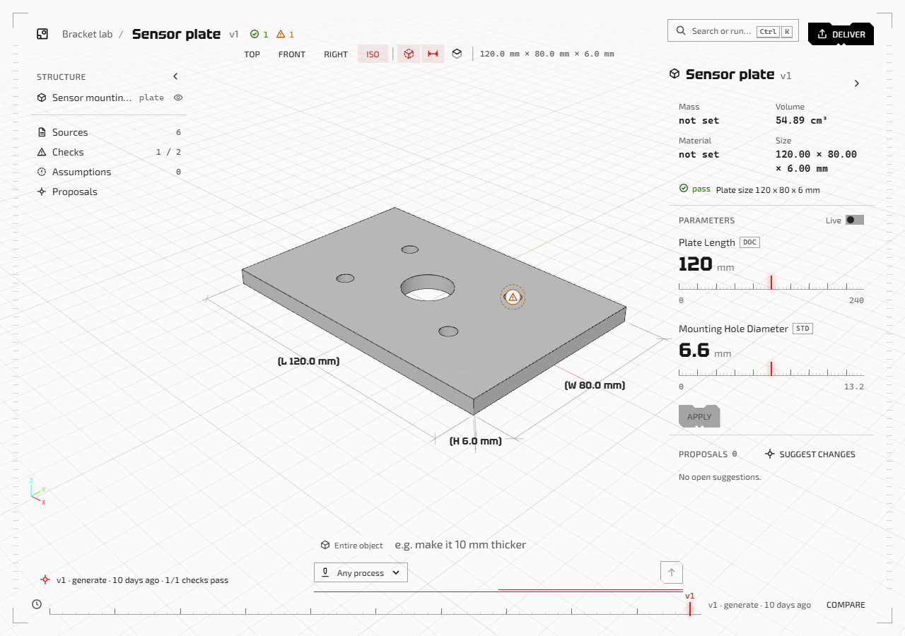
</p>
<p align="center"><sub>Viewer with overall dimensions and a pinned finding, structure and checks on the left, parameters with their source tags on the right, versions along the bottom. Sample data.</sub></p>

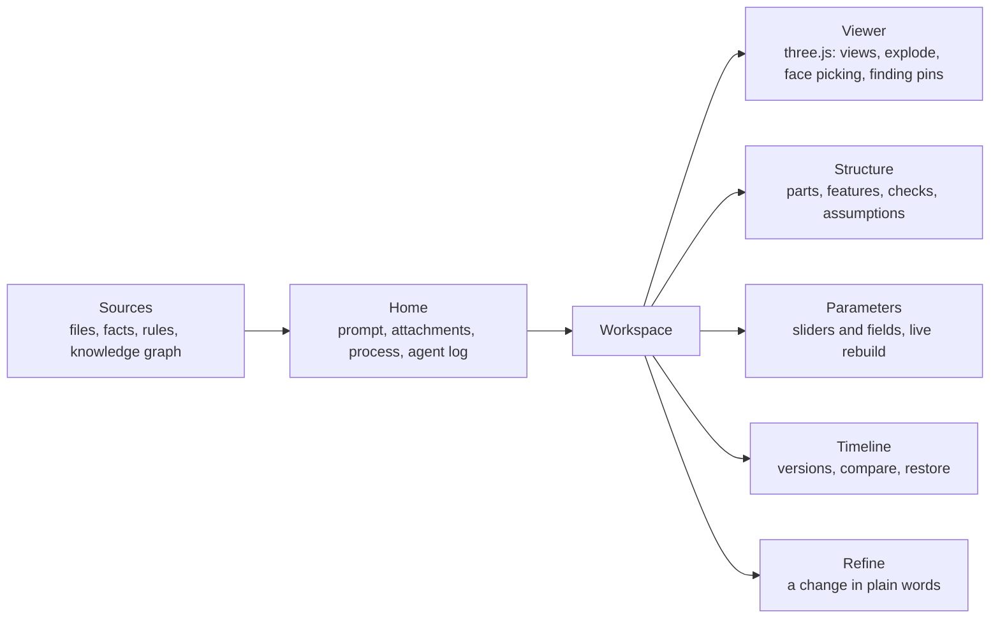

React and TypeScript, built with Vite. The viewer is three.js through react-three-fiber; it loads the GLB the kernel exported, so what you see is the exact solid, tessellated. The interface is available in English and German.

<p align="center">
  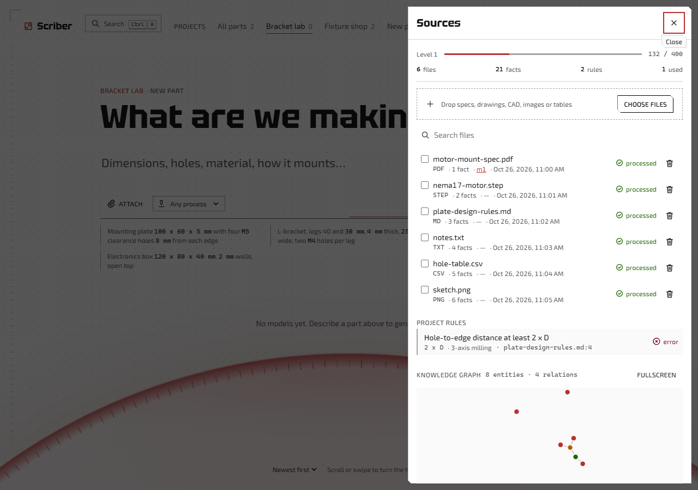
</p>
<p align="center"><sub>A project's sources: each file is reduced to cited facts, rules apply to every part made in the project, and the graph links what the files mention. Sample data.</sub></p>

### API

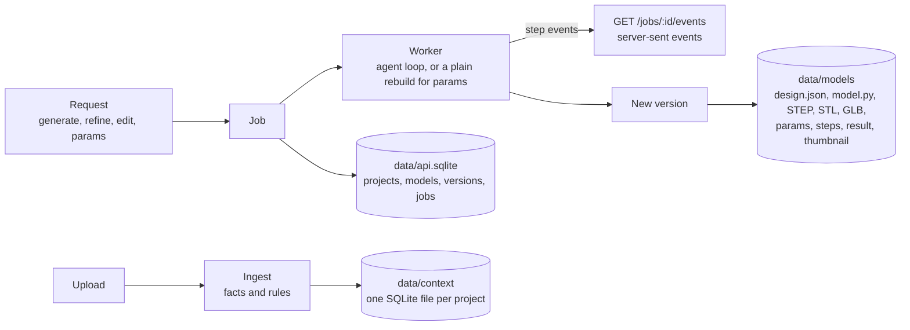

Every change is a job, and a job reports its steps as they happen, which is what the agent log in the web app shows. `PATCH /models/{id}/params` is the fast path: it rebuilds without calling the model. Exports are `step`, `stl`, `glb`, `py` (the script), `ir` and `fcstd`. The full contract is in [`docs/API.md`](docs/API.md), and the running service documents itself at `/docs`.

### CLI

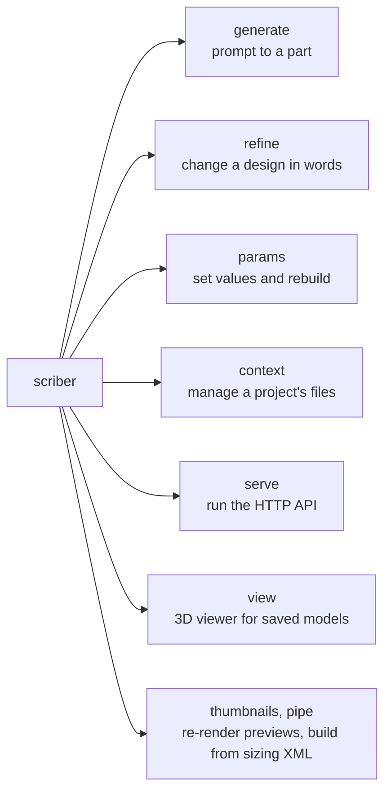

`uv run scriber --help` lists the options of each command.

## Where it stands

It works on a range of single parts and simple pairs. It is not yet reliable on harder parts, and several input paths are early. The numbers below are from this repository's own gates, with the default model on a machine with a 6 GB GPU (`docs/agents/s3-gates-2026-10-30.md`).

| Gate | Result |
|---|---|
| Development set: fully correct designs | 15 of 20 |
| Requests grounded in project documents: fully passing | 7 of 10, no rule errors |
| The same requests from the prompt alone | 5 of 10 |
| Showcase: 20 recognisable parts and small assemblies | 2 of 20 |
| Capability checklist (`docs/PARITY_REPORT.md`) | 91 of 138 rows done |

| Input | State |
|---|---|
| Text prompts for plates, brackets, flanges, turned parts and gear pairs | Works; harder parts often take several repairs or fail |
| Spec files, tables and project rules | Partly: used and cited, but stated dimensions are not always met |
| Sketches, photos and drawings | Early: dimensions are read from the image, but the designs often fail to build |
| Meshes (STL) | Early: only the size and hole sizes are used as a hint; the mesh is not reconstructed |
| Multi-part assemblies from one prompt | Early |

Limits worth knowing before you rely on a result:

- The checks cover what the requirement extractor recognised. A feature the request asked for can be missing from a part that reports every check passed, so look at the part.
- A generation takes from about 15 seconds to a few minutes on the machine above.
- The DFM checks are approximations: wall thickness is sampled and the tool or build direction is fixed at +Z.

`docs/KNOWN_ISSUES.md` has the full list.

## Next steps

| Next | Why |
|---|---|
| Another training round on harder parts, assemblies and exact dimensions from specs | The showcase set is at 2 of 20, and most open checklist rows fail in the model, not the plumbing |
| A check for every feature the request states | Today a part can pass all its checks and still miss a requested feature |
| Image inputs in two steps: read the dimensions, then write the design | Dimensions are read from sketches and drawings, but the designs often fail to build |
| Mesh to CAD in the app, with the result compared against the mesh | The reconstructor exists but is not connected, so an uploaded mesh is only a size hint |
| Text edits that stay on the picked component | Picking a face already finds the parameter that drives it, but an edit in words aimed at one component can still change another |
| An adapter for OpenAI-compatible APIs | Only Ollama and Anthropic models can be used today, so OpenAI's API and servers like vLLM or LM Studio are out of reach |
| A score on a public text-to-CAD benchmark | Every number here comes from this repository's own gates |

## Quick start

Needs Python 3.12 with [uv](https://docs.astral.sh/uv/), Node 22, [Ollama](https://ollama.com) and about 6 GB of GPU memory for the 4B models (CPU works, slowly).

```bash
uv sync
ollama pull qwen3.5:4b
ollama pull qwen3-embedding:0.6b
uv run scriber --model qwen3.5:4b generate "mounting bracket, 4x M6 holes, 80x60 plate, 5 mm thick"
```

The API and the web editor:

```bash
uv run scriber --model qwen3.5:4b serve
npm ci --prefix apps/web
npm run dev --prefix apps/web
```

The API listens on `http://127.0.0.1:8000`, the editor on `http://127.0.0.1:5173`. Outputs go to `out/`, projects and models to `data/`.

The default model in `config.yaml`, `scriber-ir:4b-s3`, is a fine-tune of `qwen3.5:4b` published at [usman7384/scriber-ir-4b-s3-GGUF](https://huggingface.co/usman7384/scriber-ir-4b-s3-GGUF):

```bash
hf download usman7384/scriber-ir-4b-s3-GGUF --local-dir scriber-ir-4b-s3
cd scriber-ir-4b-s3 && ollama create scriber-ir:4b-s3 -f Modelfile
```

With it installed, drop `--model qwen3.5:4b` from the commands above. `docs/agents/training.md` has the steps to rebuild it. Requests with images go to `llm.vision` (`qwen3.5:4b`).

## Bring your own model

The agent talks to a model through one small interface, so the model is a setting, not part of the code. Two kinds work today: open-weight models served by Ollama, and Claude through Anthropic's API.

### An open-weight model through Ollama

Any model Ollama can serve works. Pull it and pass its name:

```bash
ollama pull qwen2.5-coder:7b-instruct-q4_K_M
uv run scriber --model qwen2.5-coder:7b-instruct-q4_K_M generate "Spacer ring, 30 mm outer diameter, 12 mm bore, 8 mm tall"
```

To tune it, give it an entry in `config.yaml`. A model without one runs with an 8,192-token context and the worked examples on.

```yaml
llm:
  host: http://127.0.0.1:11434   # or another machine running Ollama
  default: qwen2.5-coder:7b-instruct-q4_K_M   # used when --model is not given
  models:
    qwen2.5-coder:7b-instruct-q4_K_M: {num_ctx: 16384, few_shot: true}
```

| Option | What it does |
|---|---|
| `num_ctx` | Context window in tokens; the prompt carries the IR schema, worked examples and project knowledge, so 16,384 is a good start |
| `few_shot` | Whether the prompt includes worked examples; turn it off for a model fine-tuned on the IR |
| `think` | Turns the model's reasoning mode on or off, where it has one |
| `max_tokens` | Longest reply allowed |

Your own weights work the same way: put the GGUF next to a `Modelfile` and run `ollama create my-model -f Modelfile`, as in the Quick start. `training/wsl/Modelfile.4b-s3` is a working example.

### A model behind an API

Claude models are supported through Anthropic's API. Add an entry with `provider: anthropic`:

```yaml
llm:
  models:
    claude-opus-5-5: {provider: anthropic, effort: high}
```

```bash
export ANTHROPIC_API_KEY=...   # read from the environment, never from config.yaml
uv run scriber --model claude-opus-5-5 generate "L-bracket, legs 40 and 30 mm, 4 mm thick, 25 mm wide, two M4 holes per leg"
```

`effort` is one of `low`, `medium`, `high`, `xhigh` or `max`. Requests then leave your machine, so this is for comparison runs and is never the default.

### Which model does what

| Setting | Used for |
|---|---|
| `--model`, else `llm.default` | Writing and repairing designs |
| `llm.vision` | Requests with images: sketches, photos, drawings |
| `embeddings.model` | Searching project knowledge; always served by Ollama |

All three work with `scriber serve` too: the API uses the models it was started with. The web app has no model picker yet.

### Not supported yet

OpenAI's API and servers that copy it (vLLM, llama.cpp's server, LM Studio, OpenRouter) need an adapter that does not exist yet. One is a small job: a class with a single `chat` method, as in `services/agent/src/scriber_agent/llm.py`, chosen by a new `provider` value in `apps/cli/src/scriber_cli/config.py`.

The prompts and worked examples were tuned on the 4B model, so a different model may need `few_shot` changed. Run the gates to see whether it actually does better: `uv run scriber-evals evals/cases/dev.yaml --models <name>`.

## Checks

The steps in `.github/workflows/ci.yml`: `ruff`, `mypy`, `lint-imports` and `pytest -m "not llm"` for Python; `npm run lint`, `typecheck`, `test`, `e2e` and `parity` in `apps/web`. The `llm` tests need Ollama with `qwen3.5:0.8b-q8_0` and `qwen3-embedding:0.6b`.

## Project records

Capability parity is tracked row by row in `docs/reference/PARITY_CHECKLIST.md` and summarised in `docs/PARITY_REPORT.md` (`uv run scriber-parity-report`). A row is done only with a passing acceptance test and a recorded demo (`uv run scriber-parity <rows>`, evidence under `evals/results/`). Decisions are in `docs/DECISIONS.md`, open problems in `docs/KNOWN_ISSUES.md`, the rules for contributors in `AGENTS.md`.

## Licence

Apache-2.0, see `LICENSE`.
