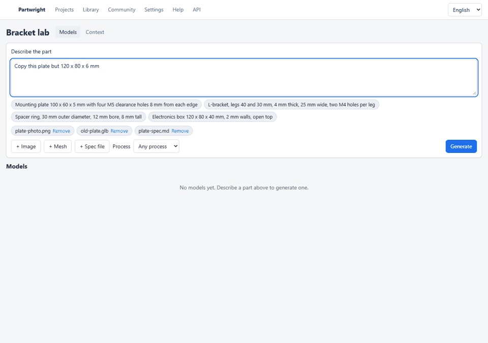

# Demo script

The GIF is stitched from the web parity run `evals/results/parity-web-20261029-054713` (mock API serving real geometry-service output) with `uv run python evals/parity/make_demo_gif.py <run> docs/demo.gif`. It shows the screens, not a live model.

Every step below runs offline on the laptop in `docs/HARDWARE.md`; the parity demos record evidence under `evals/results/`.

| Step | Command | Shows |
|---|---|---|
| Text to part | `uv run partwright generate "mounting bracket, 4x M6 holes, 80x60 plate, 5 mm thick"` | IR, build, checks and repair log; STEP, STL, GLB, params |
| Refine | `uv run partwright refine out/<model folder> "make the plate 100 mm long"` | parameter-only change, rest of the IR untouched |
| Project context | `uv run partwright context add demo evals/demos/m2/*` then `generate ... --project demo` | facts and rules cited by page and line, rule violations repaired |
| Aircraft from a sizing tool | `uv run partwright pipe < evals/parity/m4/aircraft/sizing.xml` (API running) | lofted NACA wing, no model involved |
| Mesh to parametric | `uv run partwright-parity IN-7 IN-8` | STL rebuilt as named features with exact holes |
| Assembly | `uv run partwright-parity AS-2 AS-4 PR-8` | mates, interference, mass and CoG propagation |
| Web editor | `uv run partwright serve`, then `npm run dev` in `apps/web` | viewer, parameters, findings, versions, context manager |
| Everything | `uv run partwright-parity` then `uv run partwright-parity-report` | every row's demo and the report in `docs/PARITY_REPORT.md` |
