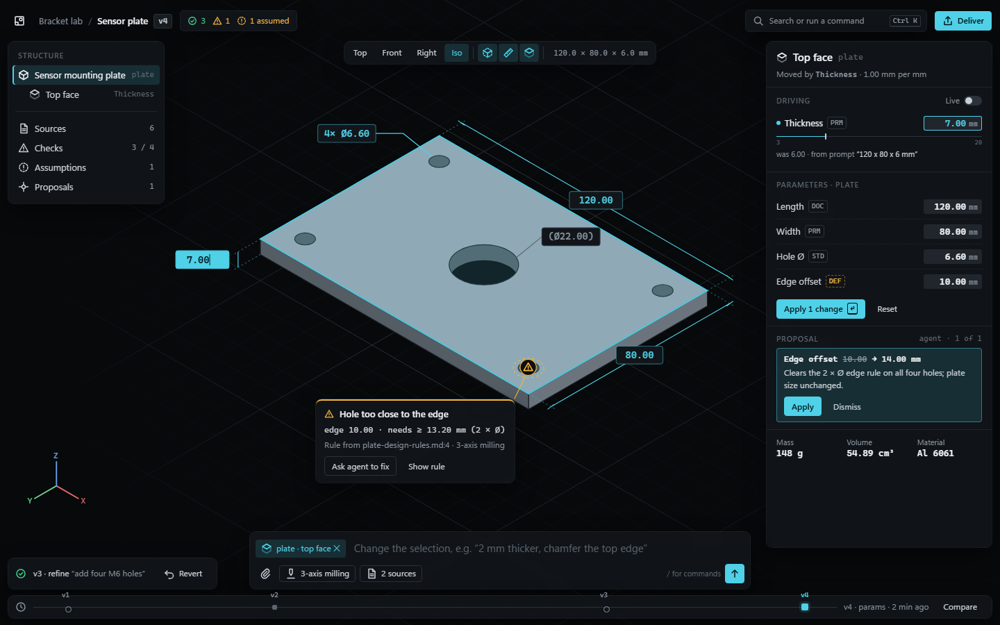
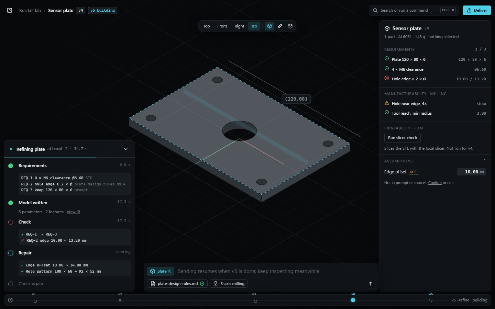
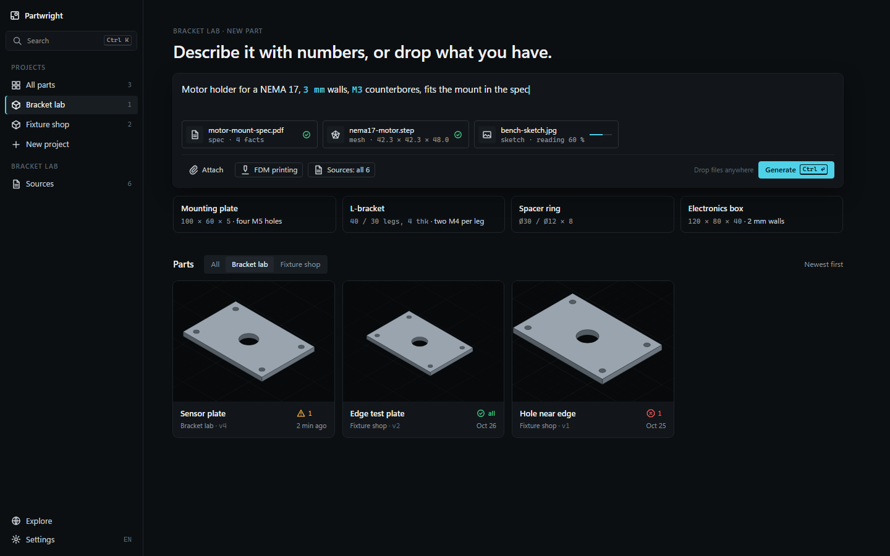
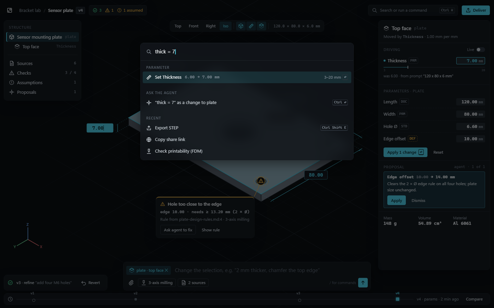
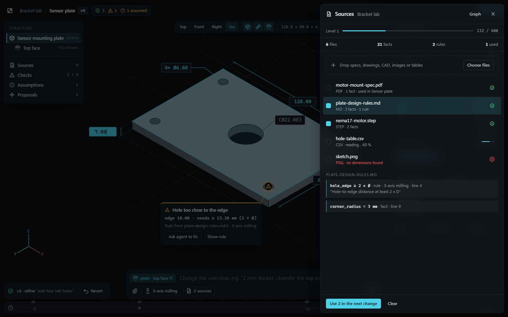
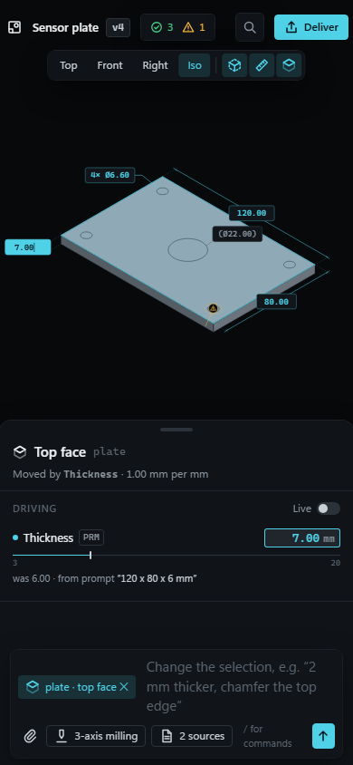
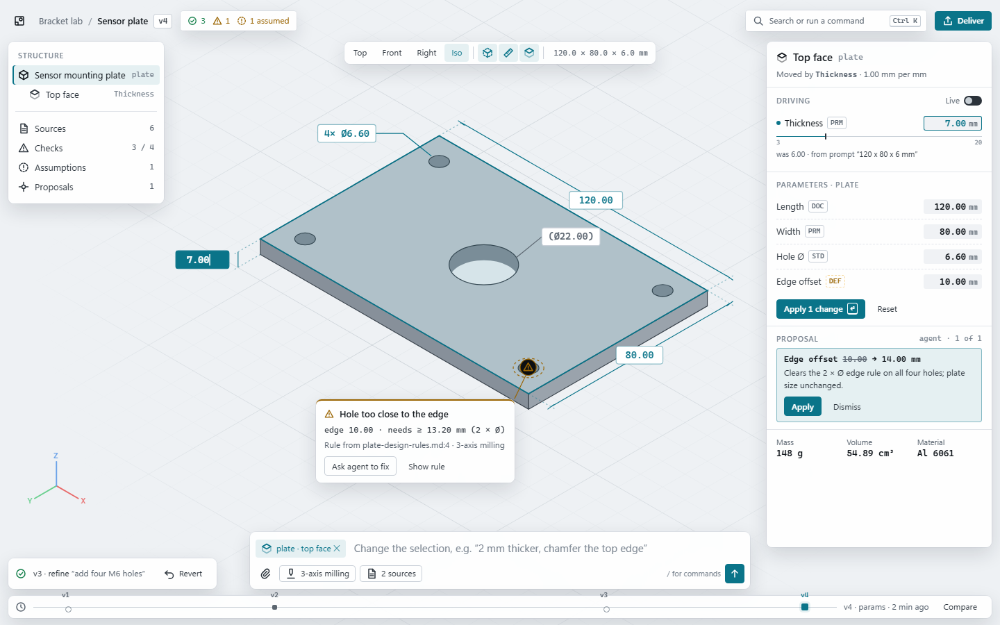

# UI direction

Status: proposed, 2026-10-29. Scope: `apps/web`. Inputs: [AUDIT.md](AUDIT.md) (today's screens, critiqued), [`mockups/`](mockups/) (static HTML of the target, with screenshots). Behaviour stays as specified in `docs/agents/web.md` and `docs/agents/parity-web.md`; this changes how it is presented and reached.

**In one line:** a dark, quiet drafting table where the part fills the screen, numbers are set like a drawing, the agent's work is a visible, reversible log, and every control appears next to the thing it changes.

| Workspace (selection, live edit, finding) | Agent at work | Home |
|---|---|---|
|  |  |  |
| Command palette ([`#palette`](mockups/workspace.html#palette)) | Sources sheet ([`#sources`](mockups/workspace.html#sources)) | 390 px, light theme |
|  |  |   |

## 1. Principles

1. **The part is the page.** The viewport is full-bleed on every model route. Everything else floats over it, shrinks to what the current selection needs, and gets out of the way when nothing is selected.
2. **Select, then act.** Picking a part, face, finding or version decides what the inspector shows and what the command bar targets. No permanent panels of settings.
3. **Numbers are drawn, not written.** Values use a monospace face with tabular figures, a unit and two decimals, sit on the geometry as dimension chips, and carry bounds and provenance wherever they appear. Driving dimensions are editable; reference dimensions are parenthesised, as on a drawing.
4. **Show the agent's work, keep it reversible.** Every job is a log of steps with checks and repairs; every result is a version on the scrubber; every agent change has a one-click Revert (a restore, so history is never rewritten). Assumptions the agent made (provenance `default`) are flagged until the user touches them.
5. **One way in for everything.** The command bar takes words; the palette (Ctrl+K) takes every action, every parameter (`thick = 7`) and every place. Buttons on screen are shortcuts into the same action registry, not a second implementation.
6. **Status is a glyph plus a word.** Pass, warn and fail each have a shape (circle-check, triangle, octagon) and a colour; colour alone never carries meaning.
7. **Calm by default.** One accent, no gradients, glow or glass beyond a light blur on viewport overlays, short motion. The interesting thing on screen is the part.

## 2. Information architecture

### Routes

| Route | Today | Target |
|---|---|---|
| `/` | Projects grid | **Home**: sidebar (projects, Sources, Explore, Settings) + composer + parts grid. With no project chosen the grid shows All parts. |
| `/library` | Library page | Home with *All parts* selected (same component). |
| `/p/:id` | Prompt card + timeline + gallery | Home with that project selected. Generate turns the composer into a live agent card in place; done offers **Open** and **Download STL**. |
| `/p/:id/context` | Context page | Home with the **Sources** sheet open. The graph opens fullscreen from the sheet. |
| `/m/:id` | Three-column editor | **Workspace** (below). |
| `/shared/:id` | Viewer + table | Workspace, read-only: no command bar, inspector read-only, Deliver offers only the shared files. |
| `/explore` | Community grid | **Explore**: the same parts grid; Fork opens a project picker on the card. |
| `/settings`, `/help` | Pages | Sheets over the current page (routes kept for deep links and the parity specs). Help = shortcuts, four short how-tos, Report a bug. |

The top navigation bar goes. Home has a sidebar; the workspace has only a breadcrumb back to its project. The palette reaches every route from anywhere.

### Workspace layout (1440 × 900)

```
┌ mark  Project / Part  v4   ✓3 ▲1 ◌1 assumed ─────────────── [Search or run…  Ctrl K] [Deliver] ┐
│┌ Structure ┐            ┌ Top Front Right Iso │ edges dims face │ 120.0 × 80.0 × 6.0 ┐ ┌ Inspector ───┐│
││ parts tree│                                                                         │ selection     ││
││ ───────── │                   full-bleed viewport, ground grid, part,               │ driving value ││
││ Sources 6 │                   dimension chips, finding pins, axis triad              │ parameters    ││
││ Checks 3/4│                                                                         │ proposal      ││
││ Assumed 1 │                                                                         │ mass · volume ││
││ Proposals │                                                                         └───────────────┘│
│└───────────┘ ┌ agent status / stream ┐  ┌ command bar: [target chip] text… [attach][process][send] ┐ │
│ [◷ ─○──────■────────○────────────■ v4 · params · 2 min ago            Compare ] version scrubber │
└──────────────────────────────────────────────────────────────────────────────────────────────────┘
```

- Rail 224 px, inspector 324 px, both collapsible (`[` `]` on the rail edge, or the palette). The camera frames the part in the free area between them, not the window centre.
- The agent status line expands upward into the stream while a job runs and collapses to one line when it ends.
- Below 1100 px the rail collapses to a 44 px icon strip; below 768 px the layout switches to mobile.

### Mobile (390 × 844)

Top bar (mark, part name, checks pill, palette button, Deliver). Viewport takes the top half. A bottom sheet holds the inspector with three snap points (peek: selection and its driving value; half; full with tabs Inspect / Activity / Versions); the command bar is pinned to the sheet's bottom edge. Home on mobile: the sidebar becomes a project switcher in the header. No route may scroll horizontally.

## 3. Smart components

Each is one small module with typed props; data comes from the routes in `docs/API.md` unless marked *gap* (see §8).

**Command bar** (`agent/CommandBar`). The one text input for the agent. Modes: *generate* (Home; multi-line; Ctrl+Enter), *refine* (workspace; Enter), *command* (a leading `/` filters the palette inline). The target chip mirrors the selection (part or face); Backspace in an empty bar clears it. Chips for process, sources in use and attachments sit on its second row. Quantities typed in the text (`6 mm`, `M3`, `Ø12`) are highlighted as recognised numbers by a pure client-side parser. States: empty (placeholder written for the current selection), typing, attachments pending (send waits for them), sending, blocked while a job on this model runs (says so and points at the stream), error (inline, text kept).

**Attachment tray** (`agent/AttachmentTray`). One Attach control, drop anywhere on Home or the workspace, paste an image. Each file is a chip with a kind glyph (sketch/image, mesh/CAD, spec/table), name, and its parse status from the ingest job: uploading %, reading %, ready (*n* facts, or a mesh's box when facts give one), failed (the API's reason, Retry, Remove). Generate carries every ready id; failed files block nothing.

**Agent stream** (`agent/AgentStream`, variants `card` on Home and `dock` in the workspace). The job's steps in arrival order: kind as a short title (Requirements, Model written, Check, Repair, Done), attempt, elapsed, progress hairline, step thumbnail. A failed check is red with its message; the repair after it is linked to it. Done summarises (version, checks passed) and offers Open / Download STL (card) or jumps the scrubber (dock). Failed shows the error and Retry (resubmits the same request). Collapsed, it is the **agent status line**: one sentence, `aria-live="polite"`, plus **Revert** for the last agent version. Structured step detail (requirement list, per-check pass/fail, parameter diff) needs `Step.detail` (*gap*); until then show `message`, and after Done compute the parameter diff from the two versions.

**Version scrubber** (`agent/VersionScrubber`). A horizontal lane, one tick per version. Agent versions (generate, refine, suggestion, variant, material) are hollow circles; user versions (params, edit, restore, fork) are filled squares; the shown one is the accent. Hover: thumbnail, origin, prompt, time, number of parameters changed. Click: preview that version (viewer and inspector read-only, banner "Viewing v2 · Restore as v5 · Back to v4"). Compare: pick two, see a parameter diff table and the other version as a ghost outline. `[` and `]` step; Home and End jump.

**Inspector** (`workspace/inspector/*`). Content follows the selection:

| Selection | Shows |
|---|---|
| nothing | Part name and version, mass, volume, material, bbox; requirement checks; assumptions; all parameters. |
| part | Name, id, material, parent and joint; its parameters (all parameters until `Param.part` exists, *gap*). |
| face | "Moved by *Thickness* · rate"; that parameter pinned on top with an offset field (today's Face edit). |
| finding | Message, measured vs required, rule source, suggestion, "Ask agent to fix". |
| version preview | Read-only values with the diff against the current version. |

A parameter row is: label, provenance monogram, value field (mono, right-aligned, unit inside), and a hairline scrub track with min and max (a styled `input[type=range]`; keyboard arrows step, Shift ×10, Alt ×0.1). States: default, edited (accent dot, footer "Apply *n* changes ⏎"), applying, out of bounds (field in fail colour, the bound named), error. The **Live** switch replaces "Apply instantly" (same 400 ms debounce). The monogram opens a popover with the source, its quote and `file:page:line`, linking into the Sources sheet.

| Source | Monogram | Treatment |
|---|---|---|
| prompt | `PRM` | plain |
| document | `DOC` | plain, links to the fact |
| rule | `RUL` | plain, links to the rule |
| standard | `STD` | plain, names the standard |
| user_edit | `USR` | plain |
| mesh_fit | `FIT` | plain |
| vision | `VIS` | plain |
| default | `DEF` | dashed warn outline, counted as an **assumption** in the top bar and rail |

**Dimension chips** (`viewer/DimensionChips`). Drafting-style dimensions drawn on the model: extension lines, a dimension line with slash ticks, and a chip with the value. *Reference* chips (the bbox, `L 120.0 mm`) are muted and parenthesised when they are not a parameter. *Driving* chips (the parameter that moves the picked face today; any parameter once `Param.anchor` exists, *gap*) use the accent; click or Enter to type in place, arrows to step, drag along the dimension line to scrub, Enter applies, Esc cancels. Chips avoid each other and the inspector by flipping to the other side of their edge.

**Finding pins and checks** (`viewer/FindingPins`, `workspace/ChecksPopover`). A severity glyph at `location.point`, a dashed ring around the feature, a leader to a callout on hover or focus: title, `measured · required` in mono, rule source and process, actions "Ask agent to fix" (fills the command bar with the finding and targets its part) and "Show rule" (opens Sources at the rule). The top-bar checks pill opens one popover with requirements, manufacturability and printability (with the slicer run button); a row focuses its pin and frames it.

**Proposals** (`agent/Proposals`). The suggestions API as proposals: change as a diff (`Edge offset 10.00 → 14.00 mm`), rationale, **Apply** / **Dismiss**. They show in the inspector and as a small marker at their target part; the parameter row they touch shows the proposed value as a ghost. "Ask for proposals" lives in the checks popover and the palette.

**Command palette** (`shell/palette`). Ctrl+K (or the top-bar search). Groups, in order: suggested for the selection; parameters (fuzzy on labels; `name = value` previews "Set Thickness 6.00 → 7.00 mm" with bounds); ask the agent (Ctrl+Enter sends the query as a change to the target); navigate (projects, parts, sources, Explore); view; deliver; settings (theme, language); help. Recent actions first when the query is empty. Each action is registered once in `shell/actions.ts` with its id, label key, group, shortcut and `when(context)`; buttons elsewhere call the same action.

**Deliver menu** (`workspace/DeliverMenu`). One button replaces Share, Publish and Export: Export STEP / STL / GLB / FreeCAD (disabled with the API's reason when FreeCAD is missing) / script / IR; Copy share link, Revoke; Publish to Explore; Check printability.

**Structure rail** (`workspace/StructureRail`). The component tree (nested by parent, ids in mono), visibility toggle and isolate (Alt-click) per part, the picked face as a child row; then counted links to Sources, Checks, Assumptions, Proposals.

**Sources sheet** (`sources/SourcesSheet`). Right-hand sheet: knowledge meter (level, score to next, files, facts, rules, used) as one line, drop zone, file list (status glyph, kind, facts count, used-in links, row menu with Delete and confirm), search, select files → "Use *n* in the next generation/change" (puts them into the command bar), facts and rules of the selected file with quote and page:line, Graph opens fullscreen with labels on hover and the legend.

**Empty states that teach.** Each one says what the thing is for and offers the next action in place: Home with no parts (composer focused, four starter cards with dimensions in mono); Sources empty ("Drop a datasheet: its dimensions and rules become constraints the agent must meet", Choose files); checks with no rules (link to add a rules file); palette with no match (ask the agent); no WebGL (what to enable, plus the parameter table).

## 4. Visual system

Reference implementation of every token: [`mockups/mockup.css`](mockups/mockup.css). The app's version lives in one file, `src/styles/tokens.css`; components use tokens only (CI greps for hex colours outside it).

**Type.** IBM Plex Sans (UI) and IBM Plex Mono (every number, unit, id, shortcut), both SIL OFL 1.1, self-hosted from `@fontsource/ibm-plex-sans` and `@fontsource/ibm-plex-mono` pinned exact (the repo's `.npmrc` has `save-exact`), latin + latin-ext subsets for German, woff2 only, weights 400/500/600 (sans) and 400/500 (mono). Bundled by Vite; nothing is fetched at runtime. Fallback `"Segoe UI Variable Text", "Segoe UI", system-ui` and `"Cascadia Mono", Consolas, ui-monospace`. `font-feature-settings: "tnum"` everywhere.

| Token | Size / line | Use |
|---|---|---|
| `--t-xs` | 11 / 16 | eyebrows (uppercase, 0.06em), meta, ids |
| `--t-sm` | 12 / 18 | secondary text, chips, buttons |
| `--t-md` | 13 / 20 | body, parameter rows (base size) |
| `--t-lg` | 15 / 22 | command bar text, inspector title |
| `--t-xl` | 20 / 28 | sheet titles |
| `--t-2xl` | 28 / 34 | Home heading, weight 500 |

**Colour.** Dark first; light is a full token set, chosen by Settings or the OS.

| Token | Dark | Light | Use |
|---|---|---|---|
| `--viewport` | `#07090b` | `#eef1f4` | 3D background |
| `--bg` | `#0c0f12` | `#f3f5f7` | page |
| `--surface` | `#12161a` @ 88 % + blur | `#ffffff` @ 90 % | floating panels |
| `--raised` / `--field` | `#181d22` / `#20262c` | `#ffffff` / `#f0f2f5` | rows, inputs |
| `--line` / `--line-strong` | `#1f252b` / `#2b323a` | `#e1e5ea` / `#c9d0d8` | hairlines, borders |
| `--text` / `--text-2` | `#eef1f3` / `#c9d0d6` | `#11161b` / `#2c343c` | text |
| `--muted` | `#8a949e` | `#5b6570` | secondary text (≥ 4.5:1) |
| `--faint` | `#5c6670` | `#7d8792` | disabled and decoration only |
| `--accent` | `#4fd1e8` | `#0a7489` | the one accent: selection, focus, driving dimensions, primary action |
| `--pass` / `--warn` / `--fail` | `#46d18b` / `#f2b33d` / `#ff5c5c` | `#17804c` / `#9a6400` / `#c62f2f` | check states, with glyphs |
| `--axis-x/y/z` | `#e86a6a` / `#6ad08f` / `#6aa2e8` | same | triad and grid origin only |

Computed contrast: accent on `--bg` 10.5:1 (dark) and 5.4:1 on white (light); muted 6.2:1 / 6.0:1; light pass, warn, fail ≥ 4.9:1 on white. Provenance is a monogram, not a colour; only `default` gets the warn treatment.

**Spacing** 4 px base: 4, 8, 12, 16, 24, 32, 48. Panel padding 12–14, row height 28, control height 28 (24 on dense rows, 44 touch targets on mobile). **Radii**: 3–4 px for controls and chips, 8 px for floating panels, 12 px for sheets; nothing pill-shaped. **Elevation**: one level for floating UI (`0 12px 32px rgb(0 0 0 / 45%)` plus a 1 px `--line` ring); a 14 px backdrop blur only for overlays on the viewport; sheets and the palette add a 55 % scrim.

**Motion.** `--d-fast` 80 ms (hover, press), `--d-mid` 140 ms (popovers, chips, palette), `--d-slow` 220 ms (sheets, rail collapse), camera moves 320 ms; easing `cubic-bezier(0.2, 0, 0, 1)` in, `cubic-bezier(0.3, 0, 1, 1)` out. With `prefers-reduced-motion: reduce`: camera jumps, sheets and popovers fade in 80 ms without moving, the stream does not auto-scroll, the progress hairline has no shimmer.

**Iconography.** Our own SVG set, 16 px grid, 1.5 px stroke, round caps and joins, `currentColor`, in one module (`src/ui/icons.tsx`, about 30 glyphs: mark, search, part, face, edges, dimension, document, assumption, pass, warn, fail, agent, attach, send, deliver, eye, chevrons, process, clock, grid, globe, plus, undo, image, mesh, settings). Generic icon packs lack the CAD glyphs and bring the look we are leaving. The mark is a square datum with a reference circle and a corner bracket; no wordmark styling beyond Plex Sans 600.

**Viewport.** Flat `--viewport`, no gradient or environment reflections. A ground grid on the part's z = 0 plane: minor spacing chosen from 1 / 10 / 100 mm so minor lines stay ≥ 8 px apart, a major line every 10, fading out at about 3× the part diagonal; short X and Y origin lines. Axis triad bottom-left. Part material matte neutral (`--part` tokens) with B-rep edges drawn; hover = 1 px accent outline, selection = 14 % accent tint plus 1.5 px outline. Top / Front / Right default to orthographic; Iso keeps perspective with a P toggle.

## 5. Accessibility

- WCAG 2.2 AA: text ≥ 4.5:1, glyphs and control borders ≥ 3:1 (checked from the table above; re-check any new token). Targets ≥ 24 × 24 px, 44 × 44 on touch.
- Focus: 2 px `--accent` ring with a 2 px `--bg` gap, never removed; visible on top of the 3D view. Opening a sheet or the palette traps focus; closing returns it.
- Keyboard covers everything the mouse does: Tab reaches the HUD, chips and pins in reading order (roving tabindex inside the viewport group); arrows orbit, `+`/`-` zoom when the canvas has focus.

| Key | Action | Key | Action |
|---|---|---|---|
| Ctrl/⌘ K | palette | `/` | focus command bar |
| 1 / 2 / 3 / 0 | Top / Front / Right / Iso | E / M / P | edges / dimensions / pick face |
| `[` `]` | previous / next version | Esc | close, then clear selection |
| Enter | apply drafts | ? | shortcuts sheet |

- Live regions: the agent status line (polite), apply errors (assertive). Every pin, chip and glyph has an accessible name ("Finding: hole too close to the edge, warning").
- `prefers-contrast: more` raises `--line` to `--line-strong` and drops the blur.
- EN/DE: every new string goes through `src/i18n` (`de` typed as `typeof en`), including palette actions, aria-labels and empty states. German runs about 30 % longer: chips and buttons wrap or truncate with a title, never clip. Number formatting stays `.`-decimal mono in both languages (engineering convention, matches the API); dates follow the chosen language.

## 6. Delete or merge

| Today | Becomes |
|---|---|
| Top nav (Projects, Library, Community, Settings, Help, API, language select) | Home sidebar + palette; API link and server URL in Settings; language in Settings and palette |
| Projects page, Library page, project Models tab | One Home with a project filter |
| Project / Context tabs, Context page | Sources sheet |
| Settings page, Help page | Sheets |
| Prompt card: textarea, four long chips, + Image / + Mesh / + Spec file, process select | Composer (command bar, generate mode) with one Attach, drop anywhere, starter cards, process chip |
| Timeline card | Agent stream (card / dock) and status line |
| Editor header: New generation, Share, Publish, Export, Report a bug | Breadcrumb + Deliver menu; New generation and Report a bug in the palette and Help |
| Viewer toolbar of buttons and checkboxes | HUD over the viewport |
| Components and History columns | Structure rail; version scrubber |
| Parameters, Requirement checks, Manufacturability, Printability, Suggestions sections | Inspector (by selection), checks pill and popover, finding pins, proposals |
| Refine box under the viewer | Command bar, refine mode |
| Face edit bar | Inspector face state + driving chip |
| "Use selected as context (0)" full-width bar | Appears only with a selection, in the sheet footer |
| Shared page parameter table | Read-only workspace |
| `styles/app.css`, `styles/theme.css` | Per-area CSS files on `styles/tokens.css`; `app.css` deleted at integration |

## 7. Work packages

**Rules for all packages.** `src/api.ts`, `src/hooks.ts`, `src/format.ts` and `e2e/mock-api.ts` / fixtures are shared and change only additively. Nobody edits `styles/app.css`; each package styles its components in its own CSS file on the tokens, and the integrator deletes `app.css` last. A package edits only the e2e specs it owns. **Keep accessible names stable** (they are what the specs select on): `Describe the part`, `Generate`, region `Generation timeline`, progressbar `Progress`, form `New generation`, list `Models`, `Bounding box`, `Top`, form `Parameters`, `<label> slider`, spinbutton `<label>`, `Apply instantly` (the Live switch's accessible name), list `Version history`, list `Components`, `button[data-id]` on tree rows, form `Refine`, `Change request`, `Target: …`, region `Suggestions`, `Share`, `Share link`, `Check printability`, `Printability`, `Finding: …`, table `Context files`, `Search files`, region `Knowledge graph`, `Fullscreen` / `Exit fullscreen`, region `Knowledge base`, table `Project rules`, `Language`, navigation `Main` / `Project`. A rename goes with the spec change in the same PR, by the spec's owner. Every package: lint, typecheck, unit, `npm run e2e`, `npm run parity` green; `language.spec` still finds zero English in DE; no off-origin request; no horizontal scroll at 390 px on its routes; a keyboard-only pass of its flows; a light and a dark screenshot of each of its screens in the PR.

**Order.** A1 lands first (small, a day). Then A2, B, C and D run in parallel. Until C lands, B and D mount today's `Timeline`, `RefineBox`, `VersionHistory`, `Suggestions` and `PromptPanel` in C's slots; C replaces them behind the props below.

### A — Foundation, shell, palette

- **A1 (first):** `src/styles/tokens.css` (replaces `theme.css`), base CSS, fonts, `src/ui/` primitives (Button, IconButton, Chip, Kbd, Status, Provenance, Popover, Sheet, Tooltip) and `icons.tsx`; split `src/i18n.ts` into `src/i18n/{common,shell,workspace,agent,home}.ts`, each exporting `{en, de}`, aggregated so `messages`, `useT` and the `language.spec` contract are unchanged. After A1 each package edits only its namespace file.
- **A2:** `Shell.tsx` without the top nav (home layout vs workspace top-bar slot), `App.tsx` routes (sheet routes for `/settings`, `/help`, redirects for `/library`, `/p/:id/context`), command palette and action registry (`src/shell/palette/*`, `src/shell/actions.ts` with `useRegisterActions` so other packages add actions from their own components), shortcut layer (`src/shell/keys.ts`), Settings sheet (theme incl. system, language, API server), Help sheet with shortcuts and Report a bug (`BugDialog` moves here; the workspace registers the action that opens it with the canvas screenshot). New `e2e/layout.spec.ts`: every route at 390 and 1440, no horizontal scroll, screenshots.
- **Owns:** `App.tsx`, `main.tsx`, `Shell.tsx`, `ProjectNav.tsx` (deleted), `SettingsPage.tsx`, `HelpPage.tsx`, `BugDialog.tsx`, `theme.ts`, `i18n.ts`, `i18n/common.ts`, `i18n/shell.ts`, `styles/tokens.css`, `src/ui/**`, `src/shell/**`; specs `language.spec.ts`, new `layout.spec.ts`.
- **Accept:** tokens only in components; fonts served from the bundle; Ctrl+K from every route, Esc closes and returns focus; palette navigates to every route, sets theme and language, runs registered actions, parses `name = value`; system/light/dark theme.
- **Keep passing:** WP-5 (navigation reaches every page), WP-13, WP-11 (with B).

### B — Workspace: viewport, overlays, inspector

- **Builds:** workspace layout in `EditorPage.tsx` (slots for C), viewport treatment (grid, triad, ortho/perspective, framing in the free area), HUD, dimension chips, finding pins and callouts, selection highlight, Structure rail, Inspector with its five states, provenance popover and assumptions, Live switch, face-pick state with driving chip, Checks popover (findings + `PrintCheck`), Deliver menu (export incl. FCStd reason, share, publish), read-only workspace for `/shared/:id`, mobile bottom sheet.
- **Owns:** `pages/EditorPage.tsx`, `pages/SharedPage.tsx`, `src/viewer/**`, `src/workspace/**` (new; absorbs `ParamPanel`, `ParamRow`, `ComponentTree`, `FaceEdit`, `Findings`, `PrintCheck`, `ExportMenu`, `ShareButton`, `PublishButton`), `i18n/workspace.ts`; specs `viewer.spec.ts`, `model.spec.ts`, `editor.spec.ts` (PR-1, PR-3, WP-3), `share.spec.ts`, `tools.spec.ts`.
- **Accept:** canvas full-bleed and the part framed clear of overlays at 1440 × 900 and 1280 × 800; bbox chips `L/W/H … mm` equal `metrics.bbox`; picking a face shows the driving chip, typing 7 + Enter sends one PATCH for that parameter only; inspector states switch with selection and Esc; every parameter shows its monogram and its quote and ref on demand; `default` parameters counted as assumptions; finding pins reachable by Tab with callouts; HUD keys; mobile sheet with three snap points.
- **Keep passing:** WP-1, VM-4, WP-11, AS-1, PR-6, PR-10, PR-1, PR-3, WP-3, EX-6, EX-4 (web), VM-9 (web), the editor half of WP-10 and `main-flow.spec.ts`.

### C — Agent I/O: command bar, attachments, activity, versions, proposals

- **Builds** in new `src/agent/**`: `CommandBar` (generate / refine / command modes, target chip, quantity highlighting in a pure `quantities.ts` with unit tests), `AttachmentTray` + `useAttachments` (upload, ingest status, ids), `StarterCards`, `AgentStream` (`card` / `dock`), `AgentStatus` (status line + Revert), `VersionScrubber` (preview, restore, compare, keys), `Proposals`. Deletes `PromptPanel`, `RefineBox`, `Timeline`, `VersionHistory`, `Suggestions` once B and D mount the new ones.
- **Props (fixed now so B and D can mount them):** `CommandBar({mode: "generate", projectId, contextIds, onJob} | {mode: "refine", modelId, target?: {id, label, kind: "part" | "face"}, onClearTarget, onJob})`; `AgentStream({jobId, variant: "card" | "dock", onDone})`; `AgentStatus({job?, versions, onRevert})`; `VersionScrubber({versions, shown, onShow, onRestore, onCompare})`; `Proposals({modelId, onApplied})`.
- **Owns:** `src/agent/**`, `i18n/agent.ts`; specs `project.spec.ts` (WP-2, WP-4, WP-6, WP-14), `editor.spec.ts` (WP-8, PR-7; coordinate the file with B by test, not by line), `main-flow.spec.ts`.
- **Accept:** one Attach, drop and paste; per-file status through to facts or the failure reason; one generate request with all attachment and context ids; starter cards fill the composer; steps in arrival order with attempt, elapsed, thumbnail and progress; Done → Open and Download STL; failed → Retry; Revert restores the previous version as a new one; scrubber previews without changing the latest, Restore makes a new version, Compare shows the parameter diff; proposals Apply makes a version with origin `suggestion`, Dismiss makes none.
- **Keep passing:** WP-2, WP-4, WP-6, WP-14, WP-8, PR-7, CX-3 (with D), `main-flow.spec.ts`.

### D — Home, Sources, Explore

- **Builds:** `src/home/**` (HomePage with sidebar, composer slot, `PartsGrid` with project filter and sort, `ProjectList` with inline New project), `src/sources/**` (SourcesSheet, FileList, FactList, RulesList, KnowledgeMeter, fullscreen GraphView with hover labels), Explore on `PartsGrid` with a per-card fork popover, teaching empty states for these screens.
- **Owns:** `pages/ProjectsPage.tsx`, `ProjectPage.tsx`, `LibraryPage.tsx`, `ContextPage.tsx`, `CommunityPage.tsx` (all replaced), `src/context/**` (moved into `src/sources/`), `ModelGallery.tsx`, `i18n/home.ts`; specs `context.spec.ts` (parity and e2e), `community.spec.ts`, `project.spec.ts` WP-5 and WP-9 (coordinate the file with C by test).
- **Accept:** `/`, `/library`, `/p/:id`, `/p/:id/context` resolve as in §2; grid newest first with thumbnails on viewport-coloured tiles; Sources: upload with per-file progress, search, delete with confirm, facts with quote and page:line, rules with source, KB numbers equal the API, graph node and edge counts equal the API, selected files flow into the next generation as `context_ids`; Explore fork lands in the chosen project and opens.
- **Keep passing:** CX-1, CX-2, CX-3, CX-5, CX-6, WP-9, WP-5 (with A), WP-10, `e2e/context.spec.ts`.

## 8. API gaps the design exposes

The UI degrades gracefully without each; listed so `docs/API.md` can decide.

- `Param.part` (scope parameters to the selected part) and `Param.anchor` (geometry for a driving dimension chip on any parameter).
- `Step.detail`: structured requirements, per-check results and the parameter diff of a repair.
- A per-model check summary (`Model.status` or counts) for status glyphs on cards; today it costs one version request per card.
- Confirming an assumption without a rebuild (set provenance to `user_edit`).
- Cancelling a running job.
- Face ids in the GLB, to highlight the face a finding names (already in `web.md` gaps).

## 9. Not doing

No chat transcript UI (the stream is a log of work, not a conversation). No dashboards, KPI tiles or gamified levels beyond the one knowledge meter line. No custom 3D gizmos beyond the triad and the HUD. No new runtime dependencies except the two font packages.
